<p align="center">
  
</p>

<h1 align="center">轨道双子星 · flami-orbitals-skill</h1>

<h3 align="center">让任何主体都成为游戏里的一帧</h3>

<p align="center">
  把一张示例图交给 Codex，生成你的专属游戏画面。<br>
  自动重绘成《轨道双子星 / Orbitals》的 80 年代赛璐璐画风，并配上章节标题、对白字幕、任务 HUD 与特写小窗。
</p>

<p align="center">
  
  
  
</p>

<p align="center">
  <a href="#画面特点">画面特点</a> ·
  <a href="#效果预览">效果预览</a> ·
  <a href="#安装">安装</a> ·
  <a href="#使用">使用</a> ·
  <a href="#出图方式">出图方式</a> ·
  <a href="#目录">目录</a> ·
  <a href="#欢迎晒图">晒图</a> ·
  <a href="#许可">许可</a>
</p>

---

## 画面特点

- **80 年代赛璐璐画风**：把主体重绘成《轨道双子星 / Orbitals》的老动画质感，不是给照片套滤镜。
- **游戏界面元素**：章节标题、拟声词、对白字幕、任务 HUD、头像卡，按画面需要组合。
- **干净的主体构图**：以完整人物和动态姿态为主，搭配少量功能性 HUD；不添加局部放大框或细节特写窗口。
- **内框 + 纯黑外底**：主画面放在内框里，框外统一纯黑；画框和小窗口的尺寸、边框粗细参考 `assets/frame-size-reference.png`。
- **越框与鱼眼**：主体的一部分从不同方向越过并遮住边框，形成空间层次；框内带轻微鱼眼弯曲，人物和文字保持清晰。
- **安静的背景**：低对比、少细节、留白充足，让主体和界面成为视觉重点。
- **默认宇宙场景**：深空、行星轨道、空间站、小行星地表等，星空稀疏克制。
- **默认日文对白**：底部对白和说话人标签用日文。
- **默认 4:3 横版**：改画幅时拓展并重排画面，不拉伸主体、不裁掉关键内容。

以上都是默认值，你在请求里指定的文字、语言、场景和比例优先。

## 效果预览

输入示例图，输出《轨道双子星 / Orbitals》风格效果图。

| Before | After |
| :---: | :---: |
|  | 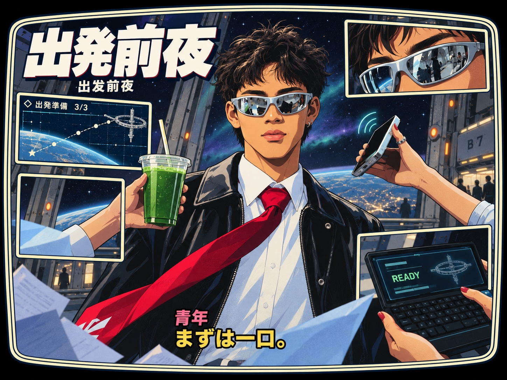 |
|  | 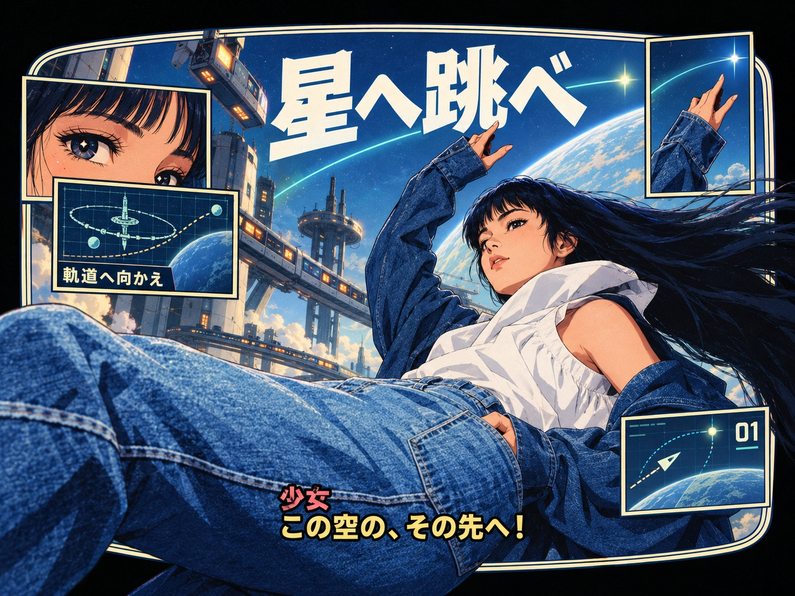 |
|  |  |
|  | 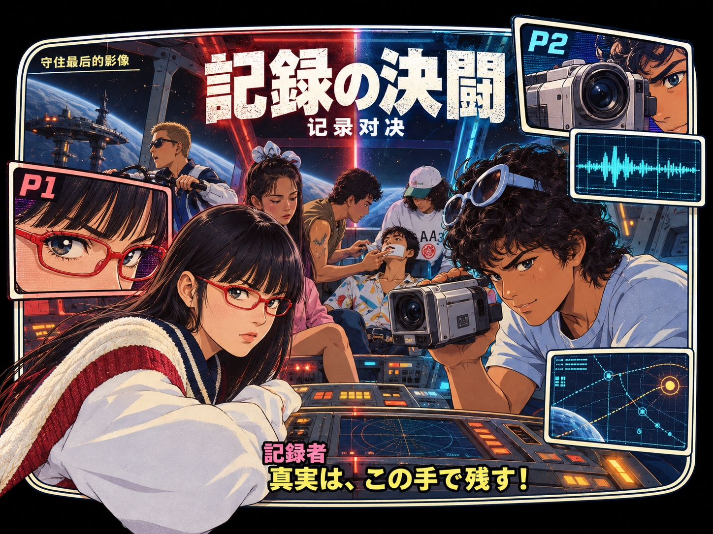 |
| 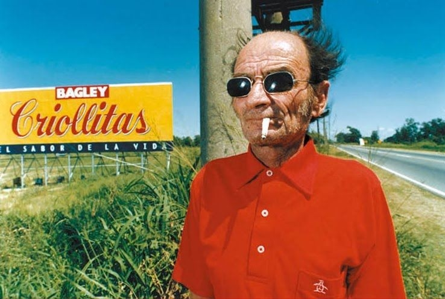 | 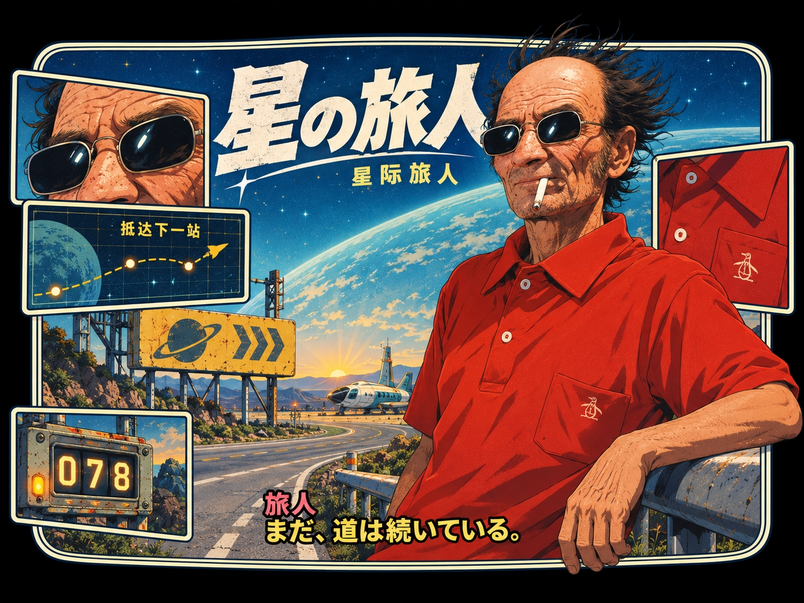 |
| 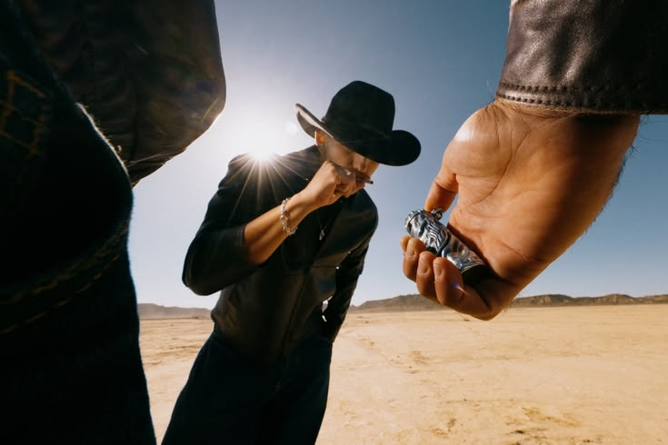 | 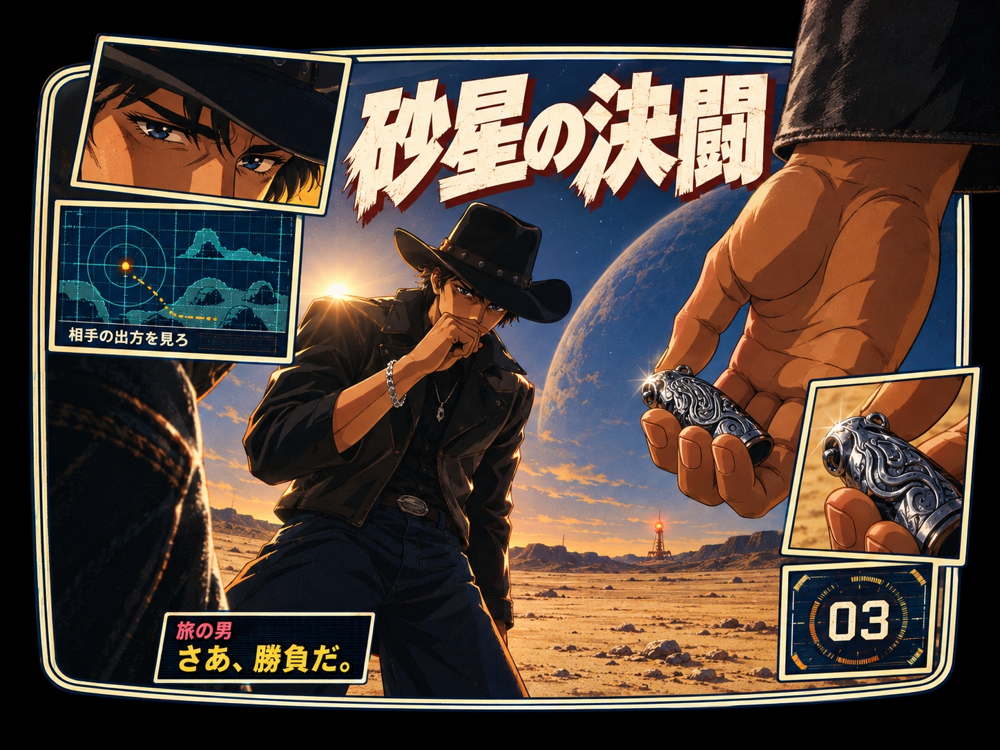 |
| 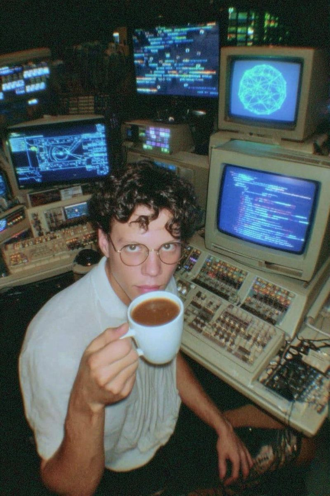 | 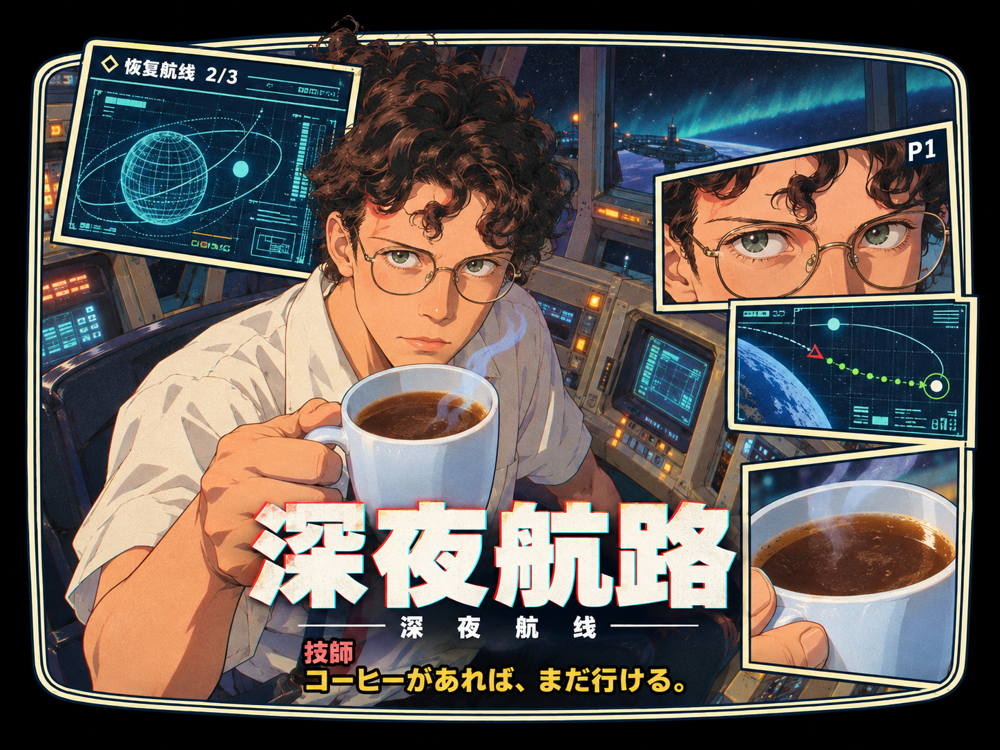 |
| 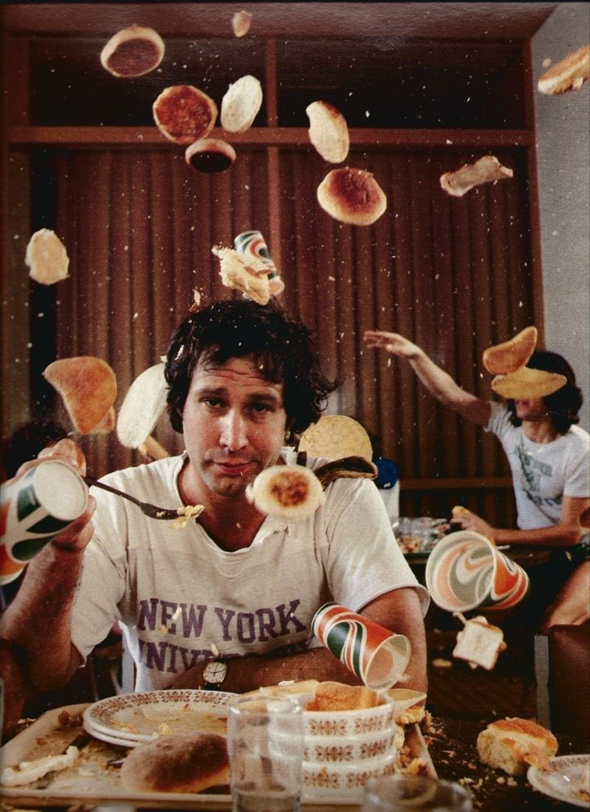 |  |
|  | 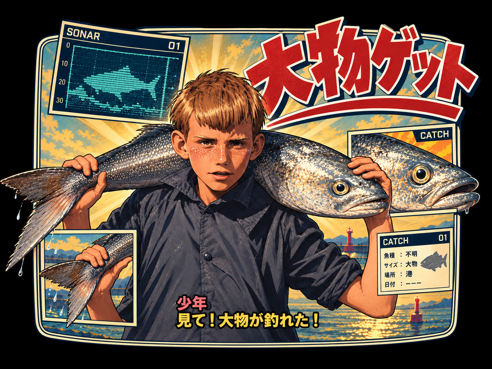 |

## 安装

### 1. Agent 安装

把下面这条指令复制给 Codex：

```text
请从 https://github.com/yesyflami/flami-orbitals-skill 安装完整的 flami-orbitals-skill 到我的 Codex Skill 目录，保留全部素材，不修改 Skill、脚本或 API 配置。
```

### 2. Git 安装

```bash
git clone https://github.com/yesyflami/flami-orbitals-skill.git ~/.agents/skills/flami-orbitals-skill
```

安装后在 Codex 中新开一个对话使用。

### 3. ZIP 使用

[下载 ZIP](https://github.com/yesyflami/flami-orbitals-skill/archive/refs/heads/main.zip)，可以直接把 ZIP 和示例图一起上传到 **ChatGPT 网页端**，让它读取 Skill 后生图：

```text
请读取 ZIP 中的 SKILL.md 和参考文档，按这个 Skill 把我上传的示例图生成一张效果图，保留主体特征和 Skill 的默认风格。
```

也可以解压，将完整的 `flami-orbitals-skill` 文件夹放入 `~/.agents/skills/`，供 Codex 使用。网页端需要能够读取附件并使用生图功能。

## 使用

**输入示例图 → 输出效果图。**

在 Codex 中上传一张示例图，再发送：

```text
请使用 $flami-orbitals-skill，把我上传的示例图生成一张《轨道双子星 / Orbitals》风格的效果图，保留主体辨识特征，其余按 Skill 默认流程选择。使用内置生图工具，不修改 Skill 或 API 配置；工具不可用时请说明原因，不要自行切换 API。
```

想微调时，直接用自然语言提出要求即可，例如「改成深空极光配色」「对白换成中文」「标题小一点」「保留人物姿势，背景换成空间站」。

## 出图方式

1. **Codex 内置生图工具（优先）**：工具可用时按 Skill 直接调用，无需为内置工具另配 `OPENAI_API_KEY`。不同 Codex 环境提供的工具可能不同，安装 Skill 本身不会增加生图权限。
2. **仓库自带脚本（备用）**：Skill 原文规定，没有内置工具时可使用 `scripts/generate.py` 调用 OpenAI Images API。需要 Python 3 和 `OPENAI_API_KEY`，脚本只使用 Python 标准库。上面的 Codex 使用指令要求工具不可用时说明原因，不会自行切换到这条路径。

仓库保留原有脚本和 API 行为：默认模型为 `gpt-image-1`，可通过 `OPENAI_IMAGE_MODEL` 指定模型、`OPENAI_BASE_URL` 指定兼容服务地址。密钥请仅在自己的环境中配置，不要写入仓库或聊天消息。脚本支持的横版尺寸为 1536×1024（3:2），并非默认目标 4:3；使用脚本时应如实说明尺寸偏差。

## 目录

```
SKILL.md                     工作流
references/style-guide.md    画风 / 配色 / 字体 / 质感
references/composition.md    构图层级、六种版式、变化规则
assets/previews/             Before / After 效果预览
assets/style-refs/           风格参考图（游戏截图，版权归原游戏所有，后续将替换为自制示例）
assets/frame-size-reference.png  画框与小窗口的尺寸参考图
scripts/generate.py          OpenAI 出图脚本
agents/openai.yaml           Codex 界面元数据
```

## 欢迎晒图

用这个 skill 画出了满意的图？欢迎到 [Issues](https://github.com/yesyflami/flami-orbitals-skill/issues) 发出来，顺便说说用了什么主体、色调和版式。效果不理想、文字乱码或者有改进想法，也欢迎在那里反馈。

这个 skill 不会向作者回传任何数据：你的照片、描述和生成的图片只会发给你自己使用的生图服务（Codex 或 OpenAI），作者看不到。

## 许可

本仓库的文档和脚本以 [MIT 许可证](LICENSE) 发布，可自由使用、修改和再发布，保留署名即可。

`assets/style-refs/` 中的图片是游戏截图，版权归原游戏所有，不在 MIT 授权范围内。
