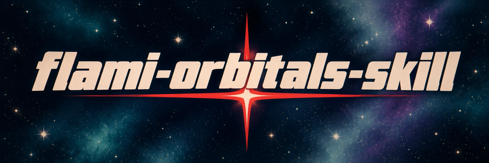

<p align="center">
  
</p>

<h1 align="center">轨道双子星 · flami-orbitals-skill</h1>

<h3 align="center">让任何主体都成为游戏里的一帧</h3>

<p align="center">
  把一张照片或一句描述交给 Agent，说一句你想画什么。<br>
  自动重绘成《轨道双子星 / Orbitals》的 80 年代赛璐璐画风，并配上章节标题、对白字幕、任务 HUD 与特写小窗。
</p>

<p align="center">
  
  
  
  
</p>

<p align="center">
  <a href="#画面特点">画面特点</a> ·
  <a href="#安装">安装</a> ·
  <a href="#使用">使用</a> ·
  <a href="#出图方式">出图方式</a> ·
  <a href="#目录">目录</a> ·
  <a href="#许可">许可</a>
</p>

---

## 画面特点

- **80 年代赛璐璐画风**：把主体重绘成《轨道双子星 / Orbitals》的老动画质感，不是给照片套滤镜。
- **游戏界面元素**：章节标题、拟声词、对白字幕、任务 HUD、头像卡，按画面需要组合。
- **多层交叠的小窗口**：4–5 个大小不一、错位叠压的界面窗口，其中 1–2 个是主体的局部特写；窗口内容跟着主体走，不套固定模板。
- **内框 + 纯黑外底**：主画面放在内框里，框外统一纯黑；画框和小窗口的尺寸、边框粗细参考 `assets/frame-size-reference.png`。
- **越框与鱼眼**：主体的一部分从不同方向越过并遮住边框，形成空间层次；框内带轻微鱼眼弯曲，人物和文字保持清晰。
- **安静的背景**：低对比、少细节、留白充足，让主体和界面成为视觉重点。
- **默认宇宙场景**：深空、行星轨道、空间站、小行星地表等，星空稀疏克制。
- **默认日文对白**：底部对白和说话人标签用日文。
- **默认 4:3 横版**：改画幅时拓展并重排画面，不拉伸主体、不裁掉关键内容。

以上都是默认值，你在请求里指定的文字、语言、场景和比例优先。

## 安装

本地 ZIP 安装：解压后将完整的 `flami-orbitals-skill` 文件夹放入 `~/.codex/skills/`（Codex）或 `~/.claude/skills/`（Claude Code）。可直接修改本地文件并重新打包，无需 Git 提交。


**Codex**

```bash
git clone https://github.com/yesyflami/flami-orbitals-skill.git ~/.codex/skills/flami-orbitals-skill
```

**Claude Code**

```bash
git clone https://github.com/yesyflami/flami-orbitals-skill.git ~/.claude/skills/flami-orbitals-skill
```

## 使用

- 「把这张照片做成轨道双子星风格」
- 「画一张轨道双子星风格的橘猫，用熔炉色调、道具获得版式」

可选指定：
- 色调：红幕菜单 / 深空极光 / 遗迹森林 / 熔炉 / 金色漩涡 / 跃迁霓虹 / 控制室
- 版式：章节标题卡 / 角色切入 / 道具获得 / 双人分屏 / 主菜单 / 对话特写
- 比例：4:3（默认）/ 16:9 / 竖版 / 方形
- 场景：宇宙（默认）/ 自行指定

## 出图方式

1. 环境自带生图工具（如 Codex）时直接使用；
2. 否则使用 `scripts/generate.py` 调用 OpenAI Images API（仅需 Python 标准库），需设置 `OPENAI_API_KEY`。

## 目录

```
SKILL.md                     工作流
references/style-guide.md    画风 / 配色 / 字体 / 质感
references/composition.md    构图层级、六种版式、变化规则
assets/style-refs/           风格参考图（游戏截图，版权归原游戏所有，后续将替换为自制示例）
assets/frame-size-reference.png  画框与小窗口的尺寸参考图
scripts/generate.py          OpenAI 出图脚本
agents/openai.yaml           Codex 界面元数据
```

## 许可

本仓库的文档和脚本以 [MIT 许可证](LICENSE) 发布，可自由使用、修改和再发布，保留署名即可。

`assets/style-refs/` 中的图片是游戏截图，版权归原游戏所有，不在 MIT 授权范围内。
